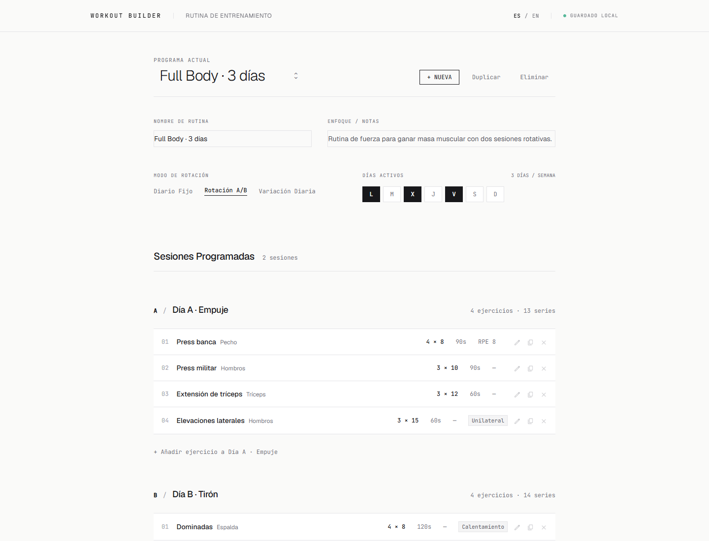

# Workout Builder

Creador de rutinas de entrenamiento para la app **Fitness Tracker**. Aplicación
web sencilla para preparar rutinas desde el navegador: puedes crearlas desde cero
o importarlas desde un PDF, una imagen o texto pegado, y exportarlas en varios
formatos.



## Qué puedes hacer

- Crear una rutina con nombre, descripción, días activos y ejercicios.
- Organizar los ejercicios por grupo muscular, series, repeticiones, descanso,
  RPE/RIR, porcentaje, calentamiento, notas y supersets.
- Importar rutinas desde **PDF**, **imagen** (OCR) o **texto pegado**, incluido
  Markdown con tablas.
- Exportar a **CSV** compatible con la app Fitness Tracker, **PDF**, **JSON** y
  **Markdown**.
- Ver el **volumen semanal** por grupo muscular y el equilibrio torso/pierna.
- Trabajar sin cuenta, sin registro y sin subir datos a ningún servidor.

## Cómo usarlo

No hace falta instalar nada:

1. Abre `index.html` en tu navegador.
2. Crea o edita tu rutina.
3. Exporta el archivo que necesites.

Para usar el autocompletado de ejercicios, sirve la carpeta por HTTP:

```bash
python -m http.server 8000
```

Y abre <http://localhost:8000>.

La web está publicada con GitHub Pages en
<https://digarivas.github.io/workout-builder/>. Cada push a `main` reconstruye el
sitio automáticamente.

### Importar el CSV en Fitness Tracker

1. Pulsa **Descargar CSV**.
2. Abre la app Fitness Tracker.
3. Entra en **Rutinas** y pulsa el icono de **importar**.
4. Elige el archivo. Si algún ejercicio no existe, la app te pedirá su grupo
   muscular y lo creará.

> Consejo: usa los nombres que aparecen en el autocompletado para que la
> importación sea perfecta y no se dupliquen ejercicios.

## Importar desde PDF, imagen o texto

- **PDF:** se extrae el texto con [pdf.js](https://mozilla.github.io/pdf.js/).
- **Imagen:** se usa OCR con [Tesseract.js](https://tesseract.projectnaptha.com/)
  en español e inglés.
- **Texto:** pega la rutina y pulsa **Analizar texto**. Reconoce días como
  `Día 1`, `Lunes` o `Día A/B`, series como `4x8` o `3 series x 10`, descansos
  como `90s` o `@90`, intensidad `RPE 8`, `RIR 2` o `80%`, supersets `A1/A2` y
  tablas Markdown con `|`.

## Privacidad

Todo se guarda en el `localStorage` de tu navegador. La página no tiene servidor,
no crea cuentas y no envía tus rutinas a ningún sitio. Las librerías de PDF y OCR
se cargan desde un CDN únicamente cuando las usas.

## Estructura

```
index.html              Página principal
css/style.css           Estilos propios
js/i18n.js              Textos en español e inglés
js/model.js             Modelo de rutina y exportadores CSV/JSON/Markdown
js/parser.js            Detección de rutinas en texto, PDF y OCR
js/app.js               Interfaz, persistencia e importación/exportación
data/exercises_lite.json Catálogo de ejercicios
```

Es una página estática: HTML, CSS y JavaScript, sin paso de compilación.

## Créditos

El catálogo de ejercicios deriva de
[hasaneyldrm/exercises-dataset](https://github.com/hasaneyldrm/exercises-dataset),
de Hasan Emir Yıldırım, publicado bajo licencia MIT. Solo se usan nombres y
grupos musculares. Consulta [THIRD_PARTY_NOTICES.md](THIRD_PARTY_NOTICES.md).

## Licencia

[MIT](LICENSE).
